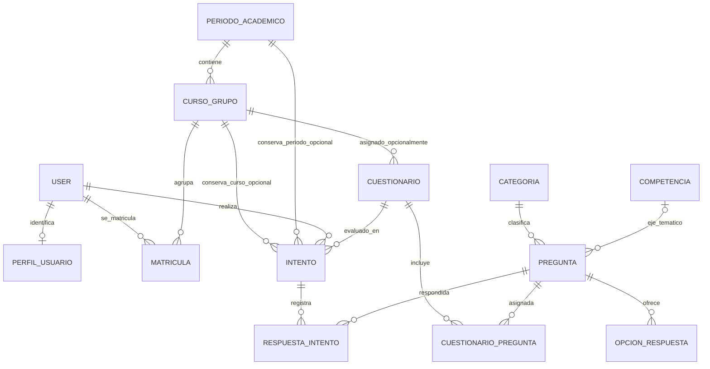

# Esquema de modelos para consultas y reportes

## Modelos y relaciones relevantes

- `User` (Django): cuenta del estudiante, con nombre, apellidos y usuario.
- `PerfilUsuario`: identificación institucional única asociada a cualquier
  usuario registrado.
- `PeriodoAcademico`: año (`anio`) y etiqueta de período (por ejemplo, `2026-1`).
- `CursoGrupo`: grupo académico perteneciente a un período.
- `Matricula`: relación estudiante-curso, con matrícula activa y un campo opcional
  de identificación.
- `Cuestionario`: evaluación con preguntas asignadas, nota máxima y nota mínima
  de aprobación configurables; su curso es opcional.
- `Intento`: intento de un usuario en un cuestionario. Los campos opcionales
  `curso` y `periodo` conservan la asignación académica al iniciar el intento.
- `RespuestaIntento`: una fila por pregunta del intento; su opción puede estar
  vacía cuando no fue contestada.
- `Pregunta`: contiene el enunciado, puntaje, categoría y competencia.
- `OpcionRespuesta`: opciones posibles de una pregunta, con marca de correcta.
- `Categoria` y `Competencia`: clasificación temática de las preguntas.

## Ruta hasta la calificación

`User (estudiante) -> Intento -> RespuestaIntento -> Pregunta -> Categoria /
Competencia (eje temático)`. El intento también apunta al cuestionario y guarda
su curso y período opcionales. Al iniciar, copia ambas relaciones académicas
del cuestionario; por tanto, cambios futuros en esas asignaciones no
reclasifican ese intento histórico. Los intentos anteriores a esta relación
permanecen sin curso ni período.

Las respuestas no modifican por sí solas el puntaje. Al enviar (o cerrar por
vencimiento), `Intento.calcular_puntaje()` suma el puntaje de las respuestas
correctas, lo divide por el puntaje disponible y normaliza el resultado a la
nota máxima del cuestionario:

`calificación = (puntaje correcto / puntaje total de preguntas) * nota_maxima`

El cálculo usa `Decimal` y redondeo `ROUND_HALF_UP` a dos decimales. La
aprobación compara esa nota con `Cuestionario.nota_aprobar`; no hay un umbral
global único.

## Diagrama de relaciones

## Disponibilidad de datos para los filtros

| Filtro o dato | Situación previa | Esquema disponible para reportes |
|---|---|---|
| Año académico | No existía | `PeriodoAcademico.anio` |
| Período | No existía | `PeriodoAcademico.nombre` |
| Curso/grupo | No existía | `CursoGrupo`, enlazado al período |
| Matrícula | No existía | `Matricula`, enlaza usuario y curso |
| Estudiante | Ya existía como `User` | Nombre, apellidos y usuario |
| Eje temático | Existía `Competencia`, relación opcional en pregunta | Se filtra por competencia |
| Curso/período de intento | No existían | FK nullable en `Intento`, ambas asignadas al iniciar |
| Identificación | No existía | Única en `PerfilUsuario`; se copia a `Matricula` para estudiantes |

Las nuevas claves foráneas que tocan datos históricos son nullable. No se
rellenan ni se alteran respuestas, calificaciones o intentos históricos.
